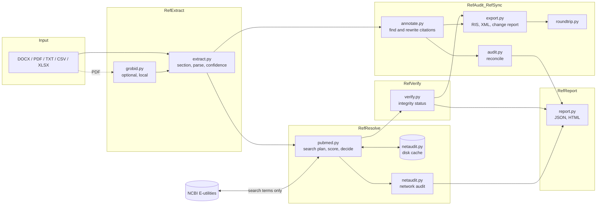
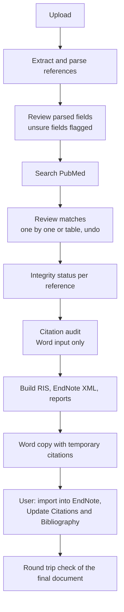

# Architecture

RefCheck 2.0 is a Python package (`refcheck/`) with two front ends that share one pipeline:
the Streamlit app (`app.py`) and the command line (`refcheck_cli.py`). The benchmark and
validation scripts are kept in a separate validation package and use the same package.

## Modules

| Brief module | Files | Responsibility |
|---|---|---|
| 1 RefExtract | `extract.py`, `grobid.py` | read DOCX, PDF, text, tables; find the reference section; split and parse references; per field parse confidence; optional local GROBID |
| 2 RefResolve | `pubmed.py`, `netaudit.py`, `config.py` | staged PubMed search, candidate scoring, abstention, typed errors, retries, rate limiting, disk cache, offline mode, network audit |
| 3 RefVerify | `verify.py` | integrity status per reference with field level findings and their sources |
| 4 RefAudit | `annotate.py` (detection), `audit.py` | find every in text citation in body, tables, legends, footnotes and endnotes; reconcile with the reference list |
| 5 RefSync | `annotate.py` (rewrite), `export.py`, `roundtrip.py` | RIS and EndNote XML, temporary citations, structure check, change report, round trip validation |
| 6 RefPrivacy | `privacy.py`, `safexml.py`, `.streamlit/config.toml` | self deleting workspaces, safe names, hosted or local detection, safe XML parsing |
| 7 RefReport | `report.py`, `export.py` | JSON and HTML integrity reports with provenance; Excel and CSV tables |
| 8 RefPlatform | `refcheck_cli.py`, `app.py`, `Dockerfile`, `docker-compose.yml`, CI | batch command line, app, container, continuous integration |

Shared helpers: `textutil.py` (normalisation, similarity), `review.py` (side by side fields for
the review screen), `pipeline.py` (orchestration used by both front ends).

## Workflow

## Data passed between stages

| Object | Produced by | Key fields |
|---|---|---|
| parsed reference | `extract.parse_reference_text` | `num, text, authors, title, journal, year, volume, issue, pages, doi, pmid_hint, parse_method, confidence, parse_note` |
| match result | `pubmed.match_reference` | `status, best, second, abstain, identifier_hits, methods_run, error_kinds, note` |
| decision map | `pipeline.default_decisions`, `apply_overrides` | `{ref_num: (pmid, AUTO_MATCH or MANUAL or REVIEW or NO_MATCH or ERROR)}` |
| integrity | `verify.classify_all` | `status, flags, findings[code, severity, detail, source], decided_by` |
| citation log | `annotate.annotate_docx` | `location, paragraph, form, order, original, replaced_with, refs, problem, context` |
| audit | `audit.citation_audit` | mapping, citations without reference, uncited, duplicates, order, numbering, styles |
| report | `report.build_report` | everything above plus provenance and the network audit |

## Architectural changes in 2.0 and why

| Change | Reason |
|---|---|
| `PubMedClient._fetch` is the only network call; tests replace it | cache, retries and audit are exercised by tests instead of being bypassed |
| `decide()` replaces `classify()` (kept as a wrapper) | explicit abstention with reasons; thresholds from `Settings` |
| `verify.py` separate from matching | matching answers "which publication", verification answers "is the citation correct"; they are evaluated separately |
| `audit.py` separate from `annotate.py` | auditing works even when no Word copy is wanted (`--audit-only`) |
| `report.py` | one machine readable record of each run, with provenance, for reproducibility |
| `privacy.workspace()` | manuscripts touch disk only inside a folder removed in `finally` |
| `safexml.py` | uploaded Word files are untrusted input |
| `config.py` | thresholds, cache and ablation switches without code changes |

## Status of each feature

Status as of 23 November 2026 (version 2.0.0.dev0, before the code freeze).

Legend: **implemented** (code and offline tests), **partial** (works with stated limits),
**planned** (not built). The evidence column says how a feature has been tested beyond the
offline tests. Most results below are **development results**: rules were corrected on the
same sets, so they show what the program does now, not how it will do on new data. Results on
sets kept apart while the rules were changed are marked **held out**. The final held out
evaluation on real manuscripts, the ablation and the comparison with other tools are still to
be run after the code freeze.

### Results so far

| Test | Result |
|---|---|
| Live services (PubMed, Crossref, doi.org, OpenAlex, Unpaywall, DOAJ, NLM Catalog, Retraction Watch from GitLab) | known answer suite passed in full |
| 800 case cancer benchmark, 16 error categories (PubMed answered from saved records) | every case handled as specified, no wrong PMID; 116 of 116 genuine references accepted without a flag (development) |
| References formatted in 17 CSL styles, live PubMed | no wrong PMID; 19 warnings, 17 of them correct (one source record lacked an author) and 2 false (development) |
| Hard cases (preprints, online first, notices, locators, particles) | 213 of 213 (development); a fresh set: 202 of 204 at first run with no wrong PMID (**held out**), 222 of 222 after fixes |
| Five reference datasets, 2,003 references, including generated ones | 2,002 handled as labelled, no wrong PMID (development) |
| Reference list written by a language model, 100 references, each labelled against PubMed | 100 of 100 handled as labelled, no wrong PMID (**held out**) |
| Robustness | NCBI throttling: 1,423 requests, 10 server errors, all retried; a network cut leaves the affected references unchecked and says so, none accepted; 303 and 2,206 reference lists read in order from DOCX and one and two column PDF |
| Mock manuscripts for the Word and EndNote outputs | 30 manuscripts (63 DOCX, PDF and text files) in journal, author year and EndNote formats with layout and markup traps: all citations converted to the right references, no false alarms, every planted error flagged |
| EndNote round trip | real EndNote (Windows): the 20 citation mock and a 14 reference letter, every converted citation a live EndNote citation to the expected reference |
| Real manuscripts | 93 references from a PDF: 90 matched, 3 correctly reported as not in PubMed (each DOI confirmed by Crossref); 14 references from a Word letter: all matched, 15 citations converted |

### Features

| Feature | Status | Evidence beyond the offline tests |
|---|---|---|
| DOCX, PDF text layer, TXT, MD, RTF, CSV, TSV, XLSX input | implemented | mock manuscripts in all these formats; two real manuscripts |
| BibTeX (.bib), compiled bibliography (.bbl), `thebibliography` in .tex | implemented | synthetic files only |
| DOC and ODT via LibreOffice | implemented (needs LibreOffice) | mock manuscripts converted to DOC and ODT |
| Reference lists in Word tables, bulleted lists, lists numbered with a tab, one list per chapter | implemented | mock manuscripts |
| Per field parse confidence | implemented | heuristic labels, not measured accuracy |
| GROBID PDF extraction | partial | TEI parser tested; live GROBID server not tested |
| Scanned PDFs (no text layer) | not supported: stops with a message to run OCR first | OCR is planned |
| Staged PubMed search, scoring, abstention | implemented | all results above |
| References without a title, or given only by DOI or PMID | implemented (matched only when every field given agrees) | mock manuscripts; 800 case benchmark category 15 |
| Calibrated thresholds | not adopted | the hand set points (RefCheck 1.x) are kept; weights fitted on labelled data can be used with `--scoring evidence`; thresholds are scores, not probabilities |
| Retry, back off, typed errors, rate limit, cache, offline mode | implemented | live throttling and network cut tests |
| Secondary evidence: Crossref, OpenAlex, doi.org, Unpaywall | implemented | live services suite; live runs |
| Local Retraction Watch CSV, updated from GitLab when it changes | implemented | live services suite (download, then skip when unchanged) |
| Journal checks: ISSN check digit, NLM Catalog (indexed for MEDLINE), DOAJ listing | implemented | live runs |
| Europe PMC as a secondary source | planned | |
| Integrity statuses (14) | implemented | all results above |
| Retraction, correction, expression of concern | implemented | live runs (published corrections found in both real manuscripts) |
| Citation detection: brackets, superscript, parentheses, numbers attached to words, IEEE ranges | implemented | mock manuscripts; real letter |
| Footnotes, endnotes, tables, legends, text boxes, hyperlinked citations | implemented | mock manuscripts |
| Existing EndNote, Zotero, Mendeley, Word citations left as they are and counted | implemented | mock manuscripts, including a real EndNote document |
| Citation audit (mapping, missing, uncited, order, styles, duplicates) | implemented | mock manuscripts; real manuscripts |
| RIS and EndNote XML export with validation | implemented | imported into real EndNote (Windows) |
| BibTeX export; Vancouver reference text suggested from the PubMed record | implemented | offline tests |
| Round trip validation | implemented | real EndNote output: mock manuscript and a real letter |
| Document structure comparison and change report | implemented | mock manuscripts; real letter |
| JSON and HTML reports with provenance | implemented | all runs |
| PDF report | planned (print the HTML report to PDF meanwhile) | |
| Network audit, privacy panel, hosted notice, self deleting workspaces | implemented | offline tests |
| Docker | partial | files written; image not built in the development environment |
| Batch command line | implemented | used for all runs above |
| REST API | planned | |
| Citation to claim evidence checking (RefEvidence) | planned, deliberately separate | |

### Known limits

* In a PDF, a floating text box is written at the end of its page, so its text is added to the
  reference printed last on that page (the match is not affected).
* In the Word copy of a document written by a program other than Word, EndNote's Cite While You
  Write tab was greyed out. Copying the text into a new Word document, or Save As in Word,
  restores it.
* Greek letters set in a fallback font are sometimes moved within the line by the PDF text
  layer; the reference still matches, with a title wording warning.
* English language manuscripts only.
