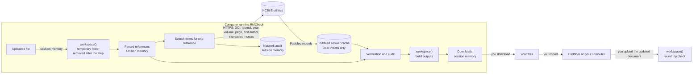

# Data flow

## Outbound network requests

| # | Destination | When | Data sent |
|---|---|---|---|
| 1 | `eutils.ncbi.nlm.nih.gov/entrez/eutils/esearch.fcgi` | each search step | `term` (built from parsed fields), `db=pubmed`, `retmax`, `retmode`, `sort`, `tool`, `email`, `api_key` if set |
| 2 | `.../ecitmatch.cgi` | when journal, year and first page are known | `bdata` = journal, year, volume, first page, first author, a constant key |
| 3 | `.../efetch.fcgi` (POST) | candidates and typed PMIDs | `id` = PMIDs |
| 4 | a GROBID server you name | only with `--grobid`, only for PDFs | the PDF. Refused unless the server is on this computer or `--grobid-allow-remote` is given |

| 5 | `.../esearch.fcgi` with `db=nlmcatalog` (optional) | once per journal | `term` = `"ISSN"[is]` or `"abbreviation"[ta]`, alone and `AND currentlyindexed` |
| 6 | `api.crossref.org/works/{doi}` (optional) | each written DOI and each matched record's DOI | the DOI, `mailto` |
| 7 | `api.crossref.org/works?query.bibliographic=` (optional) | references not found in PubMed | title, first author surname, journal, year (300 characters at most), `rows=5`, `mailto` |
| 8 | `api.openalex.org/works/doi:{doi}` and `/works?filter=title.search:` (optional) | as 6 and 7 | the DOI, or the title; `per_page=5`, `mailto` |
| 9 | `doi.org/api/handles/{doi}` (optional) | written DOIs unknown to Crossref | the DOI |
| 10 | `doaj.org/api/search/journals/issn:{issn}` (optional) | once per valid ISSN | the ISSN |
| 11 | `api.unpaywall.org/v2/{doi}` (optional) | each DOI | the DOI, `email` |

No other outbound requests are made by RefCheck. Streamlit's usage statistics are off. Every
request, with its destination host, is in the network audit (`network.requests[].host`) and counted
per destination in `network.summary.by_destination`. Secondary source answers are cached in the
same local SQLite file as PubMed answers.

## Bibliographic fields transmitted

DOI, journal title or abbreviation, publication year (and the year before and after for one title
search), volume, first page, first author surname, title words or the complete title, PMIDs.
Secondary sources (optional) add: the journal ISSN and the DOI of a matched PubMed record.
Authors other than the first, issue numbers, abstracts and any text outside the reference list
are not transmitted.
